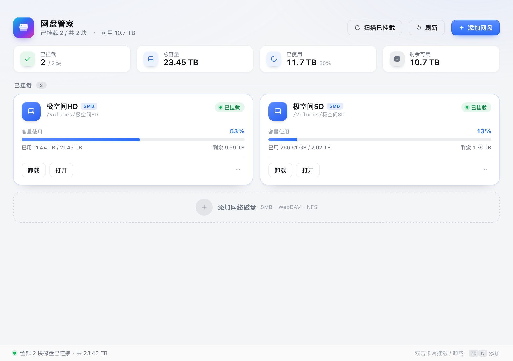

<p align="center">
  
</p>

# KesonMount

[](https://github.com/KesonLai114/KesonMount/actions/workflows/check.yml)
[](LICENSE)

[简体中文](README.md) | **English**

> Formerly NetMount. From 1.6.0 the project is **KesonMount**: existing config files, Keychain passwords, `netmount://` deep links and `NETMOUNT_*` debug environment variables are still recognized and migrated automatically.

A native macOS menu-bar app that keeps your network drives in one place: see capacity at a glance, mount/unmount with one click, and add new SMB, WebDAV or NFS shares without touching code.



## Why

Mounting a NAS share manually in Finder gives you no overview of its state or free space. KesonMount turns that into a small, proper app:

- See mount state, used/free capacity and mount path for every drive
- One-click mount, unmount and open, per drive or in bulk
- Add a Synology, QNAP, Windows share, Nextcloud, Alist, NFS export... just add a config entry
- Passwords stay in the macOS Keychain, never in the config file or command-line arguments

## Features

| Feature | What it does |
| --- | --- |
| Auto-adopt | Existing network volumes are picked up on first launch |
| Mount / unmount | Double-click a card or use a button; errors are translated into plain language |
| Bulk actions | Mount or unmount everything from the footer, menu bar or global hotkey |
| Capacity monitor | Refreshed every 4 seconds while visible; bars turn amber/red at 75%/90% |
| Add a drive | SMB / WebDAV / NFS, optional port, always mounted at `/Volumes/<share>` |
| WebDAV HTTP | HTTPS by default; switch it off for plain-HTTP LAN services (Alist 5005/5244) |
| Auto-mount on launch | Per-drive opt-in |
| Read-only mount | Uses `rdonly` and verifies `MNT_RDONLY` after mounting; unmounts if it did not take effect |
| Password safety | Passwords are read/written in-process via the Security framework, never passed through `ps` |
| Scan volumes | Manually adopt new network volumes (⌘⇧I) |
| LAN discovery | Bonjour finds NAS devices on the same network; pick a share and add it in one step |
| Reuse system credentials | Tries KesonMount's saved password, then Finder's saved password, then asks you |
| Mount source | Shows whether a drive was mounted by KesonMount or by Finder, and the real server URL |
| Menu bar icon | Left-click for a status panel, right-click for the full 19-item menu |
| Status panel | Version, summary, per-drive state and capacity, with inline mount/unmount |
| Global hotkeys | ⌥⌘M show/hide, ⌥⌘K mount all, ⌥⌘U unmount all (needs Accessibility permission) |
| Deep links | `kesonmount://mountAll`, `kesonmount://mount?id=...`, usable from Shortcuts/Raycast/scripts |
| Actionable notifications | Offline notifications include an "Reconnect now" button |
| Wake-on-LAN | Sends a magic packet if a configured NAS is asleep before retrying |
| Wi-Fi rules | Per-drive SSID allowlist; auto-remount when you get back home |
| Config backup | Export/import all drive configs without passwords |
| Diagnostics | Export redacted logs and config summary; also writes to unified logging |
| Login item | Native SMAppService startup registration |
| Hide Dock icon | Run as a menu-bar-only agent; closing the window does not quit |
| Watchdog | Checks drives by really reading a directory every 30s, reconnects with backoff after sleep/network changes |
| SMB version selector | Auto / 2.1 / 3.0 / 3.1.1, plus a one-click connection diagnostic |
| Notifications | Alerts you when a drive drops and when it comes back |
| Version everywhere | Version and build number in the title, menu bar panel and About pane |

## Quick start

Requirements: **macOS 14+** and Command Line Tools (`xcode-select --install`). Full Xcode is not needed.

```bash
git clone https://github.com/KesonLai114/KesonMount.git
cd KesonMount
./build.sh            # build, install to /Applications and open
./build.sh --no-open  # build and install only
```

The app is ad-hoc signed (no Apple Developer certificate), so on a fresh Mac Gatekeeper will block the first launch. Control-click the icon and choose **Open**, or run:

```bash
xattr -dr com.apple.quarantine /Applications/KesonMount.app
```

Build artifacts must be created on a local disk; the scripts already handle this. Keeping the source on an SMB volume is fine.

To produce universal DMG/PKG installers (Apple Silicon + Intel):

```bash
./package.sh
```

Outputs go to `dist/`. Copy the PKG to a local disk before installing — `installer` cannot install from a network volume.

## Scripts / Shortcuts

```bash
open "kesonmount://show"
open "kesonmount://mountAll"
open "kesonmount://unmountAll"
open "kesonmount://refresh"
open "kesonmount://mount?id=<drive-id>"
open "kesonmount://unmount?id=<drive-id>"
open "kesonmount://reconnect?id=<drive-id>"
```

Unknown URLs are ignored. Drive IDs can be found in `~/Library/Application Support/KesonMount/drives.json` or via **Export Config**.

## Development

```bash
./scripts/check.sh          # full check before committing / packaging
./tests/run.sh              # regression tests only
./scripts/sync-version.sh   # sync Info.plist version into the manual HTML
```

`check.sh` runs Swift type checking, UI JavaScript syntax, manual version consistency, UI-action ↔ native-bridge matching, and 98 regression assertions (including legacy `netmount://` compatibility cases). CI runs the same suite on a macOS 14 runner.

Version numbers come from `Resources/Info.plist` only. See [CONTRIBUTING.md](CONTRIBUTING.md), [CODE_OF_CONDUCT.md](CODE_OF_CONDUCT.md) and [SECURITY.md](SECURITY.md) before opening a PR or reporting a vulnerability.

## Data and security

- Drive config: `~/Library/Application Support/KesonMount/drives.json`, written atomically; external edits are backed up before write-back
- Passwords: one Keychain vault keyed by drive ID; never written to config, never in argv
- Mount point: always `/Volumes/<share>`, same as Finder; custom paths are not supported

The mount path deliberately avoids user-space mounters such as `mount_smbfs`, because they require credentials to be embedded in a URL visible in the process list. SMB/WebDAV go through the system mounter via AppleScript supplied on stdin. NFS uses an authorized system mount and falls back to a shell-escaped `sudo mount -t nfs ...` command you can run yourself.

Mounting the whole server root (`smb://host/`) is not supported: macOS NetFS requires a share name. Add one drive per share instead.

## Manual

The illustrated 25-page manual is currently Chinese only: `docs/KesonMount使用说明书-1.6.0.pdf`. It is also bundled into the app and available from **Help → User Manual** (⌘?). The layout source is `docs/说明书.html`.

## Support the project

If this tool saves you time, any support is welcome — and completely optional; no feature is locked behind it.

### WeChat Pay / Alipay

<table align="center">
  <tr>
    <td align="center">
      <br>
      <strong>WeChat Pay</strong>
    </td>
    <td align="center">
      <br>
      <strong>Alipay</strong>
    </td>
  </tr>
</table>

### International supporters

WeChat Pay and Alipay are not practical outside China. Open-source projects are usually supported through [GitHub Sponsors](https://github.com/sponsors), [Buy Me a Coffee](https://www.buymeacoffee.com/) / [Ko-fi](https://ko-fi.com/), [Patreon](https://www.patreon.com/) / [Open Collective](https://opencollective.com/) / [Liberapay](https://en.liberapay.com/), or a PayPal link.

No international payment account is configured yet. If you have one of these links, feel free to open an issue or PR to add it. Until then, a star, a bug report or a pull request is already a big help.

## License

[MIT](LICENSE). Commercial use, modification and redistribution are allowed as long as the copyright and license notice are retained.
